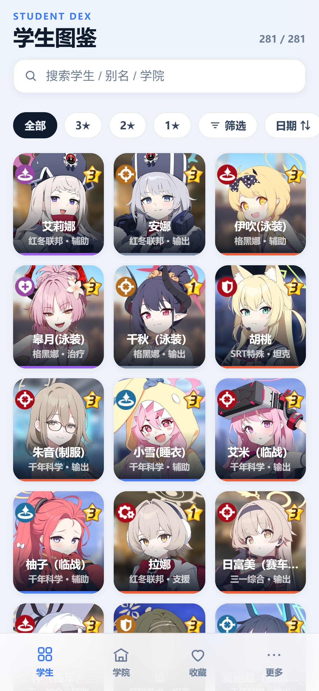
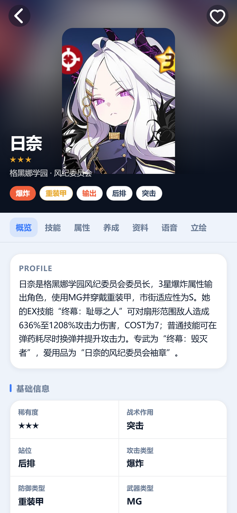
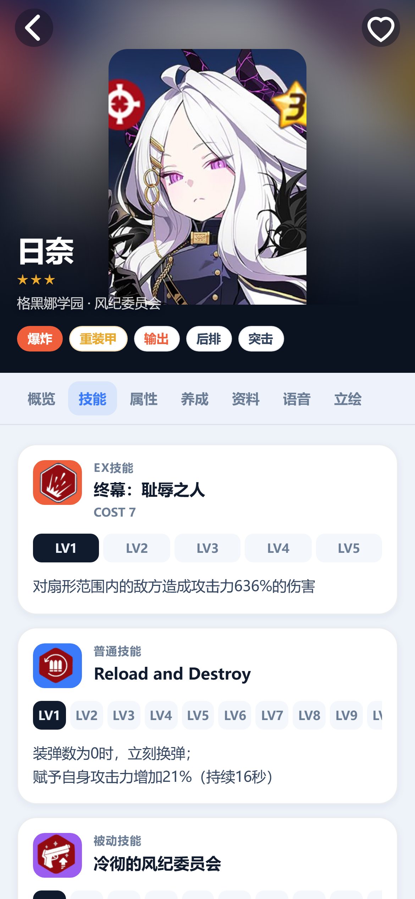
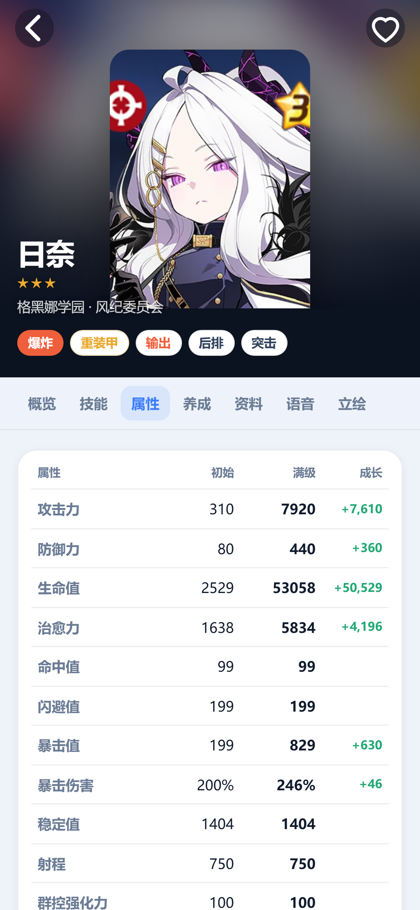
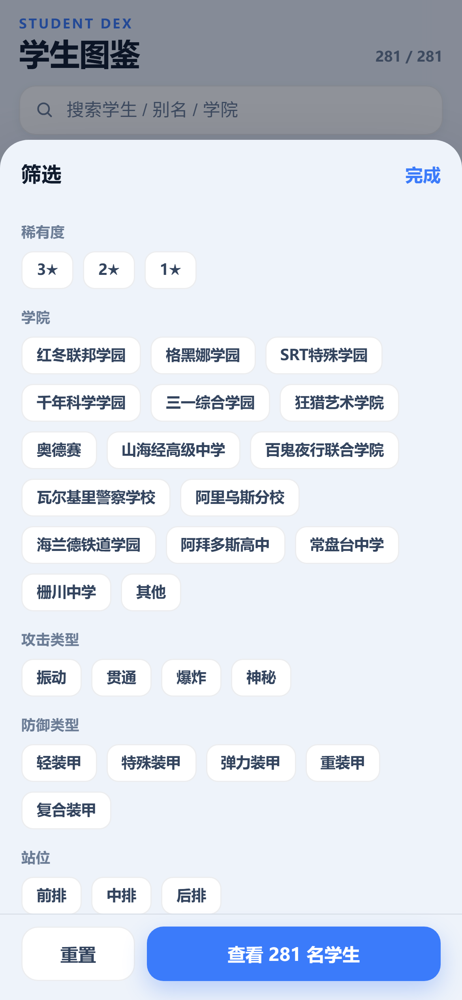
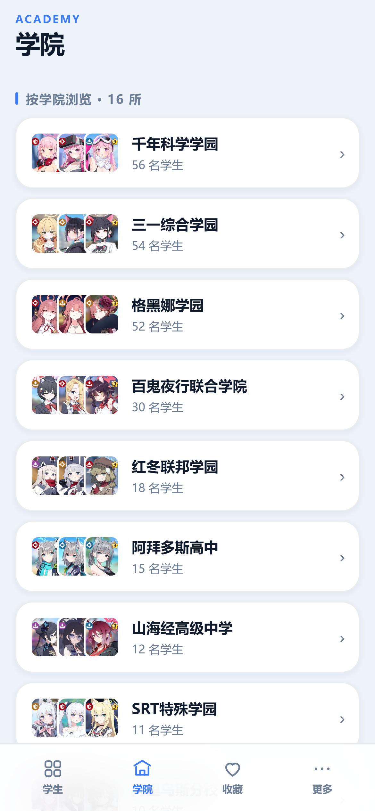
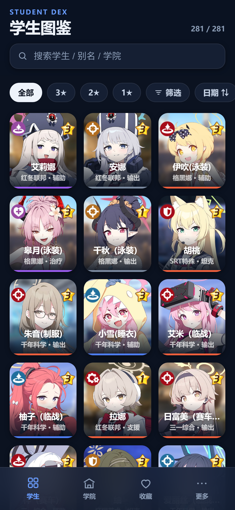

# 蔚蓝档案 · 学生图鉴（iOS / ipa）

一个可以**离线查询**《蔚蓝档案》全部 281 名实装学生详细资料的 iPhone 应用：
基础档案、技能（逐级查看）、属性数值、专武 / 爱用品、养成材料、学生资料、语音台词、立绘。

数据全部爬取自 **GameKee 蔚蓝档案 WIKI** 的「游戏图鉴 · 实装学生」页面：
<https://www.gamekee.com/ba/second/23941>

> 收录 **281 名学生 / 16 所学院 / 511 张立绘 / 2190 个图标**，全部离线打包，安装后无需联网。
>
> 另外，App **每次启动会在后台向 gamekee 检查一次是否有新实装学生**，有就自动下载并加入图鉴（详见第 8 节）。

<p align="center">
  
  
  
</p>
<p align="center">
  
  
  
</p>

---

## 1. 功能一览

| 模块 | 内容 |
| --- | --- |
| **学生** | 281 名学生网格卡片，支持按名称 / 别名（日文名、英文名、外号）/ 学院 搜索 |
| **筛选** | 稀有度、学院、攻击类型、防御类型、站位、作用、战术作用、武器 —— 8 个维度多选组合 |
| **排序** | 实装日期（新→旧）/ 名称 / 稀有度 |
| **学院** | 按 16 所学院分组浏览，点进去即筛选出该学院学生 |
| **收藏** | 心形收藏，本地保存（localStorage / App 内持久化） |
| **详情 · 概览** | 一句话简介、基础信息 10 项、地形适应（市街/屋外/屋内）、角色评测（综合评分 + 6 种玩法评级）、就业场合、抽取建议、技能速览 |
| **详情 · 技能** | EX / 普通 / 被动 / 辅助 / 子技能，**逐级滑动查看 LV1–LV10 描述与 COST**，技能升级材料表 |
| **详情 · 属性** | 初始 → 满级对照表（含成长差值）、装备词条、专武数值表、能力解放、羁绊等级奖励 |
| **详情 · 养成** | 专武（名称/描述/★2 强化技能/★3★4 解锁）、爱用品（T1/T2）、材料表 |
| **详情 · 资料** | 全名、假名、繁/简译名、年龄、生日、身高、兴趣、画师、声优（日/中/韩）、简介、礼物偏好、情人节巧克力、同名角色、原始出处 |
| **详情 · 语音** | 按「通常 / 大厅及咖啡馆 / 好感度 / 战斗 / 成长 / 事件」分类的日文原文 + 中文翻译 |
| **详情 · 立绘** | 每名学生的多张立绘（默认 / 睡衣 / 受伤 等） |

深色模式跟随系统，已适配刘海与 Home Indicator 安全区。

<p align="center"></p>

---

## 2. 目录结构

```
.
├── StudentDex/                 # iOS 工程
│   ├── project.yml             # XcodeGen 工程定义（唯一的工程配置来源）
│   ├── Sources/                # Swift 源码（SwiftUI + WKWebView 外壳）
│   └── Resources/
│       ├── Assets.xcassets     # App 图标 / 启动背景
│       └── Web/                # 打包进 App 的离线网页资源（index.html / data.js / 图片）
├── web/                        # 同一套前端（可直接用浏览器打开预览）
├── crawl/                      # 数据管线（爬取 → 解析 → 打包）
├── tools/                      # 截图工具（CDP 驱动 Chrome）
├── data/
│   ├── raw/                    # 每名学生的原始表格（570 行结构化单元格）
│   └── build/                  # 解析后的 students/*.json、头像、图标、立绘
├── .github/workflows/build-ipa.yml   # 云构建未签名 ipa
└── build-ipa.sh                # macOS 本地一键构建
```

---

## 3. 三种使用方式

### 方式 A：立刻在 iPhone 上试用（无需签名，1 分钟）

在你的 Windows 电脑上启动一个局域网静态服务器：

```powershell
cd <本项目目录>
python -m http.server 8123 --directory web
```

记下电脑的局域网 IP（`ipconfig` 里的 IPv4，例如 `192.168.1.20`），
iPhone 连同一个 Wi-Fi，用 **Safari** 打开 `http://192.168.1.20:8123/`，
然后点「分享 → 添加到主屏幕」—— 就会得到一个有图标、全屏运行、和 App 一模一样的入口。

> 数据、头像、技能图标、立绘全部是本地文件，断网也能正常使用。

### 方式 B：生成真正的 ipa（推荐，无需 Mac）

仓库内置 GitHub Actions 工作流，会把未签名 ipa 作为构建产物输出：

1. 在 GitHub 新建一个空仓库（不要勾 README）；
2. 本目录已经 `git init` 并提交过，直接推送即可：

   ```powershell
   cd C:\Users\weijunjie\Documents\gamekeedsh
   git remote add origin https://github.com/你的用户名/ba-student-dex.git
   git branch -M main
   git push -u origin main
   ```

3. 打开仓库的 **Actions → Build unsigned IPA**，等 3–5 分钟；
4. 在该次运行的 **Artifacts** 里下载 `StudentDex-unsigned-ipa`，解压得到 `StudentDex.ipa`。

完整图文步骤、Sideloadly 安装与排错见 **[docs/BUILD-IPA.md](docs/BUILD-IPA.md)**。

### 方式 C：在 Mac 上本地构建

```bash
brew install xcodegen       # 只需一次
./build-ipa.sh              # 生成 StudentDex/StudentDex.ipa
```

也可以直接用 Xcode 打开：`cd StudentDex && xcodegen generate && open StudentDex.xcodeproj`，
选择自己的 Apple ID 团队，连上 iPhone 运行（免费账号 7 天有效期）。

---

## 4. 在 Windows 上安装到 iPhone

ipa 是**未签名**的，需要用你自己的 Apple ID 重新签名后安装（免费，无需开发者账号）：

| 工具 | 说明 |
| --- | --- |
| **Sideloadly**（推荐） | Windows 原生支持，需先装 iTunes（微软商店版即可）。打开 Sideloadly → 拖入 `StudentDex.ipa` → 填 Apple ID → Start，按提示在 iPhone「设置 → 通用 → VPN与设备管理」里信任证书 |
| **AltStore / SideStore** | 装一次 AltServer，之后可以无线续签，7 天到期自动刷新 |
| **TrollStore** | 系统版本支持的情况下可永久安装，无需续签 |

> 免费 Apple ID 签名的 App 有效期为 7 天，到期后用同一工具重新安装即可；收藏数据保存在 App 内，重装会清空。

---

## 5. 数据是怎么来的

GameKee 的图鉴页面是 Vue 单页应用，数据通过接口下发：

1. `GET /v1/wiki/entry`（请求头 `game-alias: ba`）拿到词条树，
   `游戏图鉴(23941) → 实装学生(49443)` 下挂着 281 名学生，每人有独立的 `content_id`；
2. `GET /v1/content/detail/{content_id}` 拿到详情元信息与 `content_cdn`；
3. `GET content_cdn`（需 `Referer: https://www.gamekee.com/`）拿到**表格模板 JSON**，
   每名学生固定 570 行 × 8 列的单元格，含文本/图片两种单元格；
4. `crawl/parse.js` 按行号 + 行标签（`isGlobal` 标记）把表格解析成结构化字段；
5. 头像 / 技能图标 / 材料图标 / 立绘下载后按内容哈希去重、缩放、打包进 App，
   **10516 个图片 URL 去重后只剩 2190 个文件**。

重新抓取（学生实装更新后）：

```bash
node crawl/crawl.js        # 抓取全部学生原始表格（约 3 分钟）
node crawl/parse.js        # 解析
python crawl/avatars.py    # 头像
python crawl/images.py     # 技能/材料图标（增量，已有缓存会跳过）
python crawl/portraits.py  # 立绘
node crawl/build_web.js    # 生成 web/data.js
node tools/sync_web.js     # 同步进 iOS 工程资源
```

---

## 6. 技术说明

- **外壳**：SwiftUI `App` + `UIViewRepresentable` 承载 `WKWebView`，
  用 `loadFileURL(_:allowingReadAccessTo:)` 加载打包在 App 内的 `Web/index.html`，
  完全离线；外部链接用 `UIApplication.open` 交给 Safari。
- **安全区**：`ShellWebView` 在 `safeAreaInsetsDidChange` 时把原生 insets 写进 CSS 变量
  `--safe-t / --safe-b`，配合 `viewport-fit=cover`，刘海与 Home Indicator 都不会遮挡内容。
- **前端**：零依赖的原生 JS + CSS，`web/data.js` 一次性把 281 名学生的结构化数据注入
  `window.BA_STUDENTS`（约 5.6 MB），无需 `fetch`，因此 `file://` 下也能正常工作。
- **图片**：头像 320×360 JPEG、立绘 420px JPEG、图标 64–96px PNG（量化压缩），
  全部随包，不依赖任何网络请求。
- **自适应**：3 列网格 → 宽屏 4/5 列；深色模式通过 `prefers-color-scheme` 自动切换。

---

## 7. 自动同步新实装学生

App 启动约 1.2 秒后，会**在后台静默**向 gamekee 查一次学生列表；发现新学生就下载并加入图鉴，列表里会带 `NEW` 角标（保留 7 天）。

**为什么必须走原生**：页面由 `file://` 加载，直接请求 gamekee 会被 CORS 拦（接口还要 `game-alias` 自定义头），图片 CDN 还校验 `Referer` —— 浏览器侧都发不出来。所以：

```
网页 (sync.js)  --postMessage-->  Swift BridgeHandler (URLSession)  -->  gamekee
                <--__baRPC(id, status, base64)--
```

| 项目 | 说明 |
| --- | --- |
| 触发时机 | 每次启动 + 「更多 → 立即检查新学生」手动触发 |
| 节流 | 同一次运行内 30 分钟内不重复请求 |
| 单次流量 | 词条树约 0.77 MB；每个新学生约 0.4–0.6 MB（资料 + 压缩后的头像/技能/材料图标） |
| 同步内容 | 全部结构化资料、头像、技能图标、材料图标、语音；**不含立绘**（体积太大，详情页显示「暂无立绘」） |
| 存储 | `Documents/ba-sync-store.json`（原生写入，不依赖 IndexedDB/localStorage） |
| 失败处理 | 静默忽略，继续用内置数据；不会弹错误、不会卡启动 |
| 上限 | 一次最多处理 6 名新学生，多出来的下次启动继续 |

新增学生的「站位 / 战术作用」在 WIKI 上是文字图片，映射表里没有对应条目时，界面会**直接显示那张小图**（而不是留空）。

代码位置：`web/sync.js`（调度 + 解析）、`web/parser-core.js`（与 `crawl/parse.js` 共用的解析器）、
`StudentDex/Sources/WebShell.swift`（`BridgeHandler`，只允许请求 3 个 gamekee 域名）。

---

## 8. 免责声明

本项目为玩家自制的非官方资料查询工具，与 NEXON Games / Yostar 无任何关联。
学生资料、立绘、语音文本版权归原公司及 GameKee WIKI 贡献者所有，
数据仅用于学习与交流，请勿用于商业用途。
